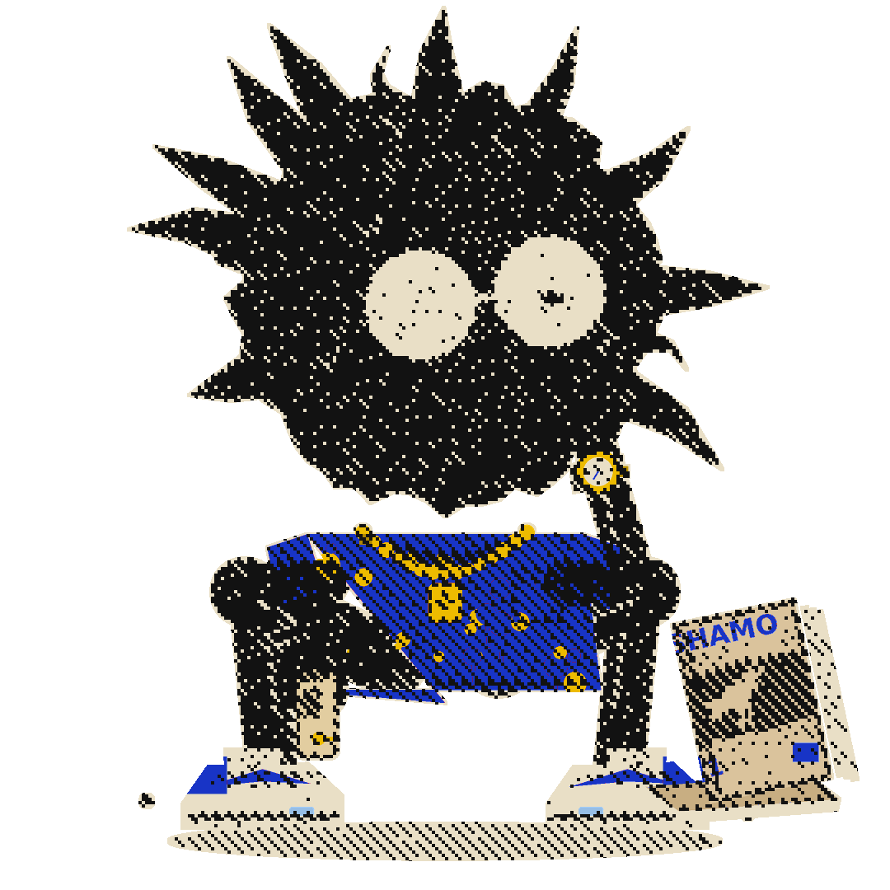

<picture>
  <source media="(prefers-color-scheme: dark)" srcset="assets/hero_dark.png">
  
</picture>

### Phyes

Bots, agents & self-hosted things — Paris.

**Projects**

- [AGC-BOT](https://github.com/PhyesGG/AGC-BOT) — Discord bot, Twitch alerts
- [LKL-BOT](https://github.com/PhyesGG/LKL-BOT) — Discord bot, tickets
- [BeatsClash](https://github.com/PhyesGG/BeatsClash) — music battles between friends
- [NixConfig](https://github.com/PhyesGG/NixConfig) — declarative config for my machines

**Currently** — running an org of 13 AI agents in my homelab.

**Stack** — TypeScript, JavaScript, Python, Nix.

**Contact** — [phyespro@gmail.com](mailto:phyespro@gmail.com)

 

Most of my work runs self-hosted, so the contribution graph only tells part of the story.
